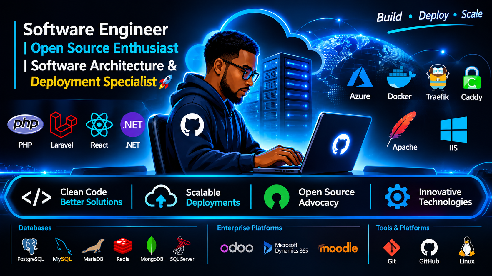

# Hey, I'm Pius 👋

I build software that solves real-world problems — from web applications and backend services to database-driven systems and scalable infrastructure.

I'm interested in clean code, thoughtful architecture, reliable systems, and building software that other developers enjoy maintaining. I'm always learning, experimenting, and improving the way I build.

---

## 🛠️ What I Work With

### Languages

### Frontend

### Backend & Frameworks

### Databases

### Infrastructure & Tooling

### Enterprise Platforms & Business Applications

---

## 🚀 What I'm Working On

- Building reliable and maintainable software.
- Improving my frontend and backend engineering skills.
- Exploring containerization, deployment, and infrastructure automation.
- Developing projects that solve practical business problems.

<!--## 📌 Featured Projects-->

<!-- Replace these examples with your actual GitHub repositories. -->
<!--
- **[Project One](https://github.com/YOUR_USERNAME/PROJECT_ONE)** — Briefly describe what it does.
- **[Project Two](https://github.com/YOUR_USERNAME/PROJECT_TWO)** — Explain the problem it solves.
- **[Project Three](https://github.com/YOUR_USERNAME/PROJECT_THREE)** — Highlight the technologies you used.
-->
## 🤝 Let's Connect

---

*Building, learning, and improving — one project at a time.*
